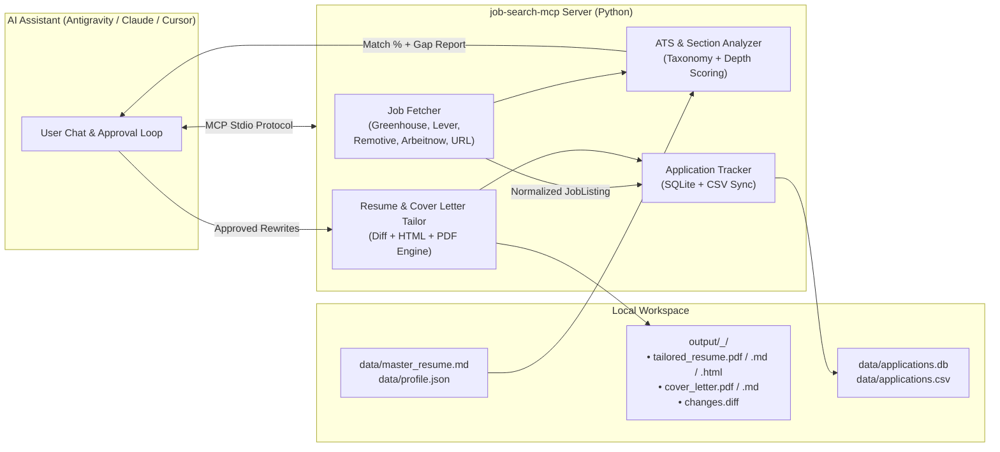

<div align="center">

# 🎯 Job Search & Resume Tailoring MCP Server

**An AI-Native Model Context Protocol (MCP) Server that discovers live jobs, performs ATS keyword & section-level gap analysis against your Master Resume, generates tailored PDF/HTML/Markdown resumes & cover letters with unified diffs, and tracks applications end-to-end.**

[](https://www.python.org/)
[](https://modelcontextprotocol.io/)
[](https://docs.pydantic.dev/)
[](https://www.sqlite.org/)
[](./src/job_search_mcp/pdf_exporter.py)
[](./LICENSE)

[Overview](#-overview) •
[Architecture](#-system-architecture) •
[Key Features](#-key-features) •
[Live Demo Output](#-example-output-before--after) •
[MCP Tools & Resources](#-mcp-tools-resources--prompts) •
[Quickstart](#-quickstart--installation)

</div>

---

## 💡 Overview

Applying to modern roles requires more than a static resume—each job description emphasizes specific domain terminology, frameworks, and measurable outcomes. Doing manual gap analysis, rewriting bullets, formatting PDFs, drafting cover letters, and updating a spreadsheet for every single role takes **45–60 minutes per application**.

**`job-search-mcp`** turns any MCP-compatible AI assistant (**Google Antigravity**, **Claude Desktop**, **Cursor**) into an autonomous **Career & GTM Copilot** that reduces a 45-minute tailoring workflow into a **60-second human-in-the-loop conversation**:

1. **Discover & Ingest:** Search live job boards (**Remotive**, **Arbeitnow**, **Greenhouse**, **Lever**, **JSearch**) or pass any job URL / raw job description.
2. **Analyze Suitability (`0–100%`):** Compare the job against your `master_resume.md` to uncover **Matched**, **Missing**, and **Underemphasized** keywords (skills listed in your `Skills` section that aren't proved in your `Experience` bullets).
3. **Tailor & Export to PDF:** Apply approved **Before → After** edits to generate a tailored `.pdf`, `.html`, and `.md` resume, a custom `.pdf` & `.md` cover letter, and a line-by-line `changes.diff`.
4. **Apply & Track:** Automatically log the application in a local **SQLite database + CSV spreadsheet** and launch the application page in your browser.

---

## 🏗️ System Architecture



---

## ✨ Key Features

| Pillar | Capabilities |
| :--- | :--- |
| **🔍 Multi-Source Job Discovery** | • Built-in zero-key integrations with **Remotive**, **Arbeitnow**, **Greenhouse ATS boards** (`stripe`, `anthropic`, `cloudflare`, etc.), and **Lever ATS boards**.<br>• Optional **JSearch (RapidAPI)** Google-for-Jobs integration.<br>• Smart **URL Scraper** supporting Schema.org `JobPosting` JSON-LD and clean HTML extraction. |
| **🧠 Two-Tier ATS Gap Analysis** | • **Keyword Coverage (75% weight):** Detects exact and alias matches across Engineering, AI/Data, Product Marketing, GTM, PLG, AEO, CRO, and MarTech taxonomies.<br>• **Experience Depth (25% weight):** Flags *underemphasized skills*—keywords present in `## Skills` that are missing from `## Experience` or `## Projects` bullets.<br>• Extracts core JD requirements and outputs prioritized (`HIGH` / `MEDIUM`) section-level recommendations. |
| **📄 Instant PDF, HTML & Diff Packaging** | • Generates a clean, selectable-text, ATS-friendly **`tailored_resume.pdf`** and **`cover_letter.pdf`** via `fpdf2`.<br>• Generates a print-ready **`tailored_resume.html`** with `@media print` styling.<br>• Computes a standard **`changes.diff`** unified diff against `master_resume.md` so every single edit is transparent and auditable. |
| **📊 Persistent SQLite + CSV Tracker** | • Caches all discovered and ingested jobs in `data/applications.db`.<br>• Automatically syncs application status (`saved`, `analyzed`, `ready_to_apply`, `applied`, `interviewing`, `offer`, `rejected`) and match scores to `data/applications.csv`. |

---

## 📊 Example Output (Before → After)

### 1. Automated Gap Analysis (`analyze_job_fit`)
```text
Job:      Inbound, AEO & PLG Growth Marketing Lead @ Hevo Data
Score:    83% Initial Match  --->  98% After Tailoring

Matched (13):        B2B Marketing, Product Marketing & Positioning, Go-To-Market (GTM),
                     Content Strategy, Demand Generation, SEO, CRO & A/B Testing (VWO),
                     Behavioral Analytics (Mixpanel, Hotjar, GA4, GSC, Looker Studio),
                     Technical Audience (SQL, Python), Marketing Analytics & Attribution
Missing (2):         AEO (Answer Engine Optimization), Product-Led Growth (PLG) & Trial Lifecycle
Underemphasized (2): Mixpanel / Hotjar / GA4 / GSC, ChatGPT / Claude AI Workflows
                     (Listed in ## Skills only — surfaced into ## Experience bullets)
```

### 2. Auditable Unified Diff (`changes.diff`)
```diff
--- master_resume.md
+++ tailored_resume.md
@@ -3,5 +3,5 @@
 ## Summary
-Data-Driven Marketing Leader with over 8 years of experience turning insights into impact across digital campaigns, content strategy, and growth funnels...
+Technical Inbound, AEO & Product-Led Growth (PLG) Marketing Leader with 8+ years of experience (and a BE in Computer Science + MBA in Marketing) owning both halves of the B2B growth funnel: organic content/SEO/AEO engines for technical buyers and self-serve trial lifecycle/CRO conversion...
```

### 3. Generated Application Package (`output/<company>_<role>_<id>/`)
```text
output/hevo-data_inbound-aeo-plg-growth-marketing-lead_manual-08899ab5/
├── tailored_resume.pdf     # Ready-to-upload ATS-optimized PDF resume
├── tailored_resume.md      # Tailored Markdown source
├── tailored_resume.html    # Styled HTML version
├── cover_letter.pdf        # Ready-to-upload PDF cover letter
├── cover_letter.md         # Tailored Markdown cover letter
└── changes.diff            # Exact line-by-line diff vs. master_resume.md
```

---

## 🛠️ MCP Tools, Resources & Prompts

### Tools
| Tool Name | Parameters | Description |
| :--- | :--- | :--- |
| `search_jobs` | `query`, `source`, `company_board`, `location`, `limit` | Search live jobs across `remotive`, `arbeitnow`, `greenhouse`, `lever`, or `jsearch`. |
| `ingest_job` | `url`, `raw_description`, `title`, `company`, `location` | Fetch & parse a job posting from any URL or save a pasted job description into the cache. |
| `analyze_job_fit` | `job_id`, `url`, `raw_description`, `title`, `company` | Score a job (`0–100%`) against `master_resume.md` and return matched/missing/underemphasized keywords + section recommendations. |
| `prepare_application` | `job_id`, `new_summary`, `bullet_rewrites`, `additional_skills`, `custom_cover_letter_markdown` | Apply approved edits, re-score the resume, and export `.pdf`, `.md`, `.html`, and `.diff` files. |
| `export_markdown_to_pdf` | `markdown_path`, `output_pdf_path` | Convert any Markdown (`.md`) resume or cover letter into an ATS-friendly `.pdf`. |
| `apply_to_job` | `job_id`, `open_browser`, `open_print_resume`, `notes` | Mark application as `applied` in SQLite/CSV and launch the application URL in the browser. |
| `get_master_resume` | *(none)* | Read `data/master_resume.md` and `data/profile.json`. |
| `update_master_resume` | `resume_markdown`, `profile_updates` | Update the master resume or candidate profile directly from chat. |
| `list_applications` | `status_filter` | List all tracked job applications and their statuses/scores. |
| `update_application_status` | `job_id`, `status`, `notes` | Update the status (`interviewing`, `offer`, `rejected`, etc.) or notes of a tracked job. |

### Resources & Prompts
- **`resume://master`** — Exposes the current `data/master_resume.md` as an MCP resource.
- **`resume://profile`** — Exposes candidate metadata and target role preferences (`data/profile.json`).
- **`applications://tracker`** — Live JSON feed of all tracked applications.
- **`analyze-and-tailor` (Prompt)** — Guided end-to-end prompt template enforcing human approval before generating application files.

---

## 🚀 Quickstart & Installation

### 1. Clone & Install
```bash
git clone https://github.com/<your-username>/job-search-mcp.git
cd job-search-mcp

# Create virtual environment & install in editable mode
python -m venv .venv

# Windows (PowerShell)
.\.venv\Scripts\Activate.ps1
# macOS / Linux
# source .venv/bin/activate

pip install -e .
```

### 2. Add Your Master Resume
Edit two files in the `data/` directory:
- **`data/master_resume.md`** — Your complete master resume in clean Markdown (`# Name`, `## Summary`, `## Skills`, `## Experience`, `## Education`).
- **`data/profile.json`** — Your contact details and target role preferences.

### 3. Connect to Your MCP Client (Antigravity / Claude Desktop / Cursor)
Add the server to your `mcp_config.json` (or `claude_desktop_config.json`):

```json
{
  "mcpServers": {
    "job-search-mcp": {
      "command": "/absolute/path/to/job-search-mcp/.venv/Scripts/python.exe",
      "args": [
        "-m",
        "job_search_mcp.server"
      ],
      "env": {
        "JOB_MCP_ROOT": "/absolute/path/to/job-search-mcp"
      }
    }
  }
}
```
*(Note: If you open this repository in **Google Antigravity**, the included workspace plugin in `.agents/plugins/job-search-mcp/` registers the MCP server automatically.)*

### 4. Run Tests & CLI Utilities
```bash
# Run automated unit & integration tests
python tests/test_job_search_mcp.py

# Run the standalone end-to-end demo pipeline
python scripts/demo_pipeline.py

# Convert any Markdown file to an ATS-friendly PDF
python scripts/md_to_pdf.py data/master_resume.md
```

---

## 📂 Repository Structure

```text
job-search-mcp/
├── .agents/
│   └── plugins/job-search-mcp/   # Auto-discovered Antigravity workspace plugin & MCP config
├── data/
│   ├── master_resume.md          # Master resume source of truth (Markdown)
│   ├── profile.json              # Candidate profile & target preferences
│   ├── applications.db           # Local SQLite cache & tracker (auto-generated)
│   └── applications.csv          # Synced spreadsheet of all applications (auto-generated)
├── output/                       # Per-job tailored resume packages (PDF, MD, HTML, Diff)
├── scripts/
│   ├── demo_pipeline.py          # End-to-end CLI demonstration
│   └── md_to_pdf.py              # Standalone Markdown-to-PDF CLI converter
├── src/
│   └── job_search_mcp/
│       ├── __init__.py
│       ├── models.py             # Pydantic v2 data models
│       ├── job_fetcher.py        # Multi-source API & URL job ingestion
│       ├── analyzer.py           # ATS keyword & experience depth analyzer
│       ├── tailor.py             # Resume rewriter, cover letter & diff generator
│       ├── pdf_exporter.py       # Pure-Python ATS-friendly PDF renderer (fpdf2)
│       ├── tracker.py            # SQLite + CSV application persistence
│       └── server.py             # MCPServer / FastMCP tools, resources & prompts
├── tests/
│   └── test_job_search_mcp.py    # End-to-end test suite
├── pyproject.toml
├── requirements.txt
└── README.md
```

---

## 👤 Author

**Sandeep T**  
*Marketing & Growth Leader | AI & Automation Builder (BE in CS + MBA in Marketing)*  
- 📧 Email: [tstsandeep@gmail.com](mailto:tstsandeep@gmail.com)

---

## 📄 License

This project is licensed under the **MIT License** — see the [LICENSE](./LICENSE) file for details.
